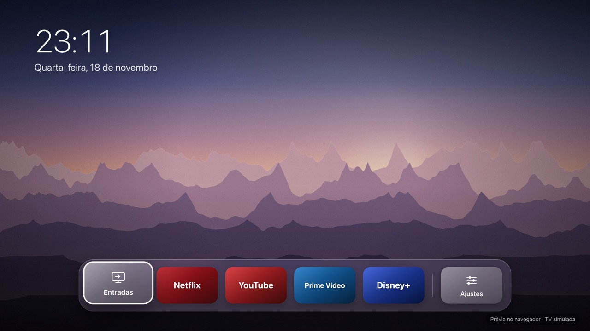
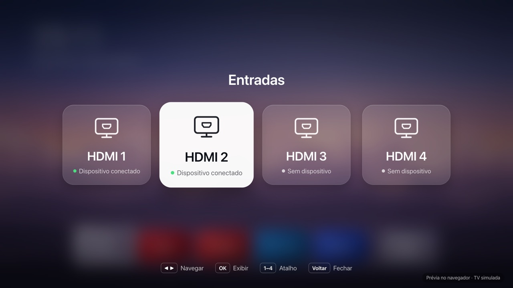
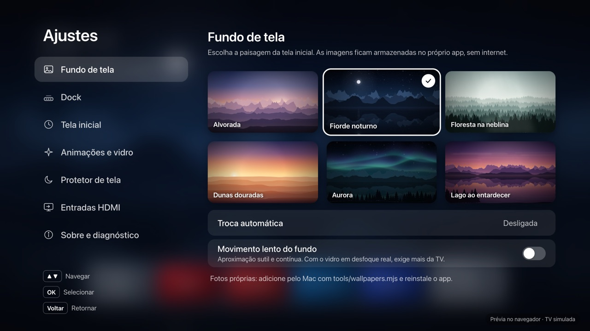

# Glass TV

Tela inicial minimalista para **TVs Samsung com Tizen** (alvo: modelos 2023, Tizen 7.0): wallpaper cinematográfico,
relógio discreto, dock de apps em vidro fosco e **acesso direto às entradas HDMI** — navegável
inteiramente pelo controle remoto.



| Entradas | Ajustes |
|---|---|
|  |  |

## Situação

| Etapa | Status |
|---|---|
| 1. Pesquisa e arquitetura | ✅ [docs/01-viabilidade.md](docs/01-viabilidade.md) |
| 2. Interface local (prévia no Mac) | ✅ completa e testada (38 testes unitários + 24 cenários E2E) |
| 3. Compatibilidade Tizen | ✅ pacote assinado com certificado Samsung (Tizen SDK via VS Code) |
| 4. Instalação na Samsung | ✅ instalado e testado na TV em 19/11/2026 — [docs/04-instalacao-na-tv.md](docs/04-instalacao-na-tv.md) |
| 5. Ajustes finais | ⏳ próximos passos |

> Na prévia do Mac, a TV é simulada. Para atualizar o app na TV:
> `sh tools/tizen.sh package && sh tools/tizen.sh install`.

### HDMI — o que é possível

A Samsung **não documenta** uma API para apps trocarem a entrada global da TV. A API oficial
`tizen.tvwindow` permite **exibir uma entrada HDMI dentro do app**; é isso que a Glass TV faz:
o HDMI aparece em tela cheia, *Voltar* retorna ao menu e as teclas 1–4 trocam de entrada.
Prováveis limitações (a confirmar): o controle não comanda o aparelho HDMI via CEC, e
Modo Jogo/áudio podem se comportar diferente da fonte nativa. Detalhes em
[docs/01-viabilidade.md §3](docs/01-viabilidade.md#3-entradas-hdmi--o-ponto-crítico).

## Prévia no Mac

```sh
open app/index.html          # ou: npm run preview
```

| Controle Samsung | Teclado do Mac |
|---|---|
| ◀ ▲ ▶ ▼ | setas |
| OK | Enter (ou Espaço) |
| Voltar | Esc ou Backspace |
| 1–4 | 1–4 (atalho de HDMI) |

A janela escala a tela de 1920x1080 mantendo as proporções da TV. Para simular
incompatibilidades: `app/index.html?hdmi=none`, `?apps=none`, `?sources=unknown`,
`?without=Disney%2B`, `?idle=5` (protetor em 5 s).

## Testes

```sh
npm test            # unitários (Node, sem dependências)
npm run test:e2e    # ponta a ponta no Chrome headless + screenshots em test-results/
```

## Funcionalidades

- **Tela inicial:** 6 wallpapers originais em transição suave (troca automática opcional),
  relógio e data, dock centralizado com foco ampliado.
- **Dock:** Entradas, apps (padrão: Netflix, YouTube, Prime Video, Disney+ — localizados
  **pelo nome** na lista da própria TV; sem IDs inventados) e Ajustes. Apps ausentes ficam
  sinalizados em vez de falhar.
- **Entradas:** cartões HDMI 1–4 com status de conexão, atalhos numéricos.
- **Protetor de tela:** wallpapers locais, transições lentas, relógio que muda de posição.
- **Ajustes:** wallpaper, apps do dock (adicionar, remover, reordenar), relógio/data/24 h,
  animações (completas/reduzidas/desligadas), vidro (desfoque real/leve), protetor, entradas
  visíveis e diagnóstico das APIs da TV.

## Configuração local e privacidade

Tudo que é do seu aparelho (IP da TV, perfil e pasta dos certificados) fica em `.env`, que o git
ignora; o modelo versionado é [`.env.example`](.env.example). Suas fotos de wallpaper
(`app/wallpapers/user/`, `manifest.user.js`), certificados, pacotes `.wgt`, `build/`, `dist/`,
`logs/` e `dumps/` também ficam fora do repositório. `npm test` inclui uma checagem que falha se
algum arquivo versionável contiver IP, MAC, caminho com nome de usuário, e-mail ou segredo.

## Segurança

Quatro privilégios públicos, **sem acesso à rede**, sem servidor na TV, sem telemetria, sem APIs
não documentadas — garantido também por testes. Ver [docs/03-permissoes-e-seguranca.md](docs/03-permissoes-e-seguranca.md).

## Documentação

1. [Viabilidade e decisões](docs/01-viabilidade.md)
2. [Arquitetura](docs/02-arquitetura.md)
3. [Permissões e segurança](docs/03-permissoes-e-seguranca.md)
4. [Instalação, atualização e remoção na TV](docs/04-instalacao-na-tv.md)
5. [Wallpapers](docs/05-wallpapers.md)
6. [Roteiro de testes na TV](docs/06-roteiro-de-testes-na-tv.md)

## Créditos

Referência técnica: [victaphu/glass-home-samsung-tv](https://github.com/victaphu/glass-home-samsung-tv)
(MIT). Nenhum código foi copiado; ideias aproveitadas e descartadas estão listadas em
[docs/01-viabilidade.md §9](docs/01-viabilidade.md#9-repositório-de-referência-victaphuglass-home-samsung-tv).
Identidade visual própria; nenhum recurso visual da Apple foi usado.
